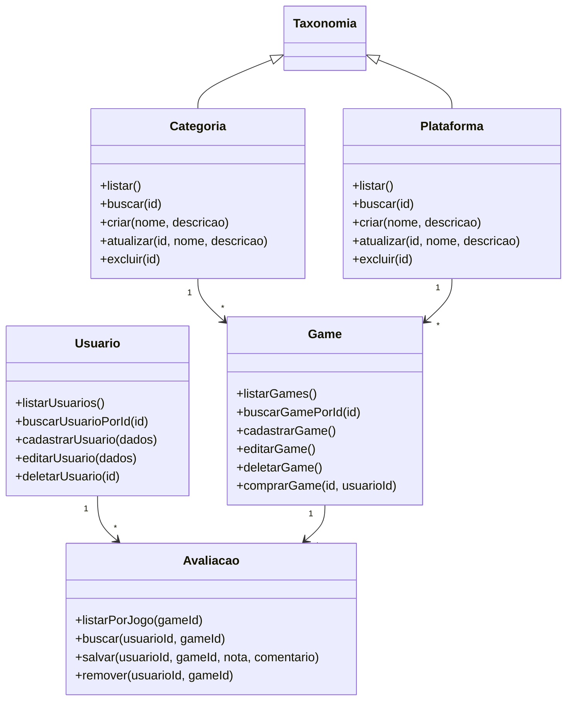
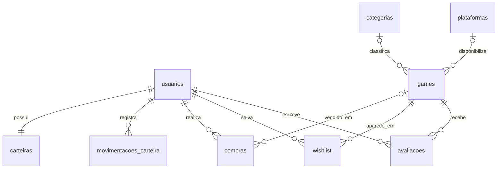
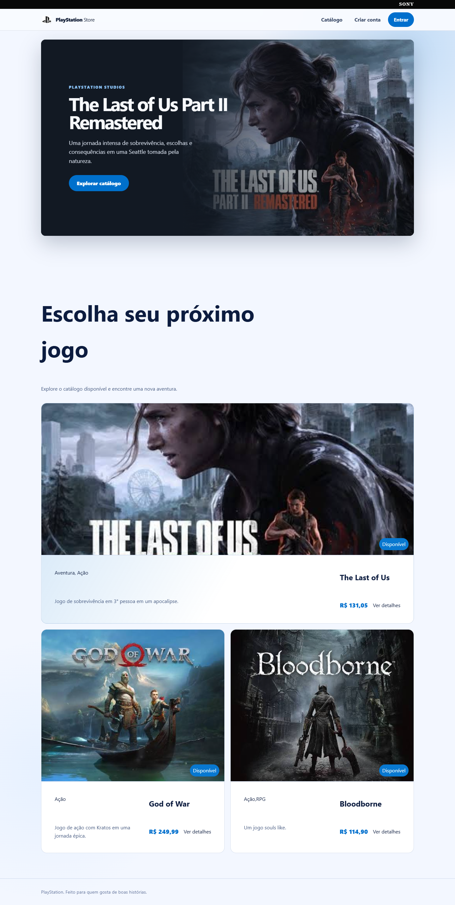
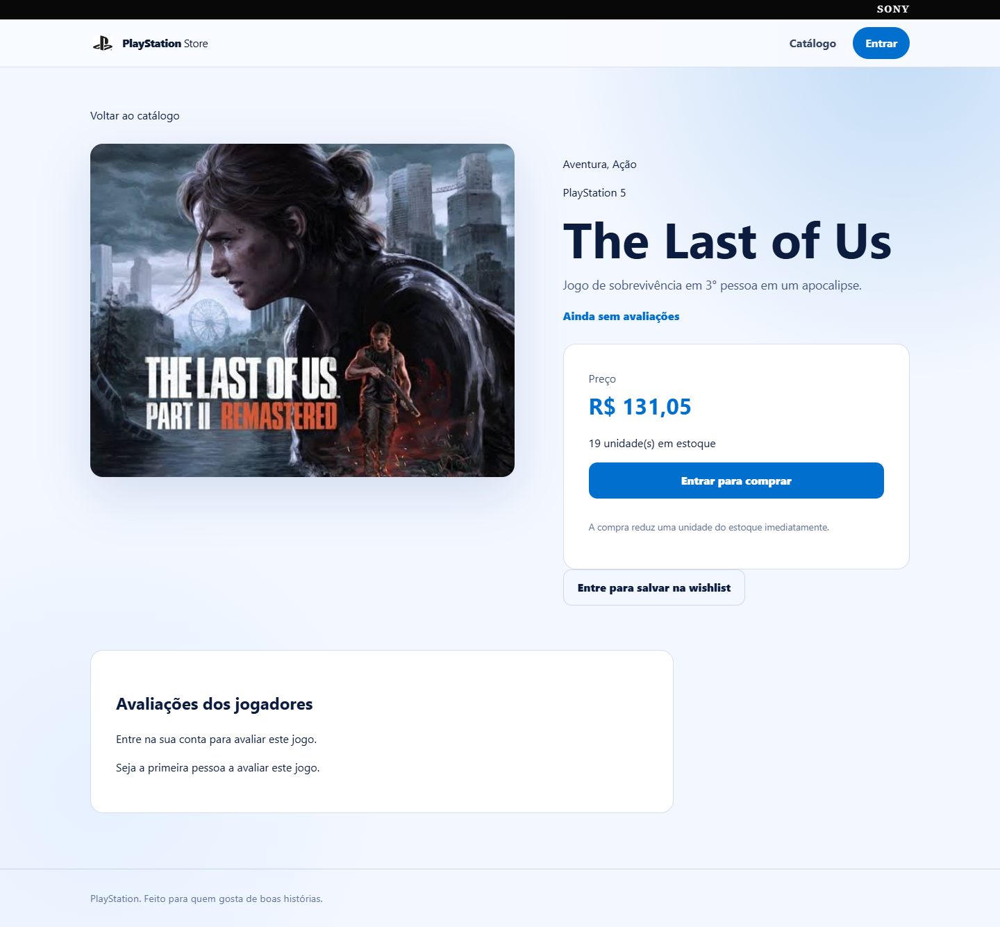
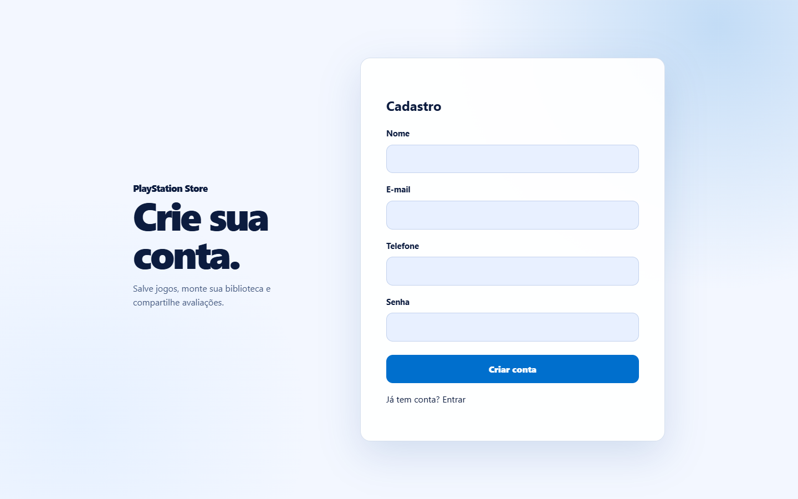
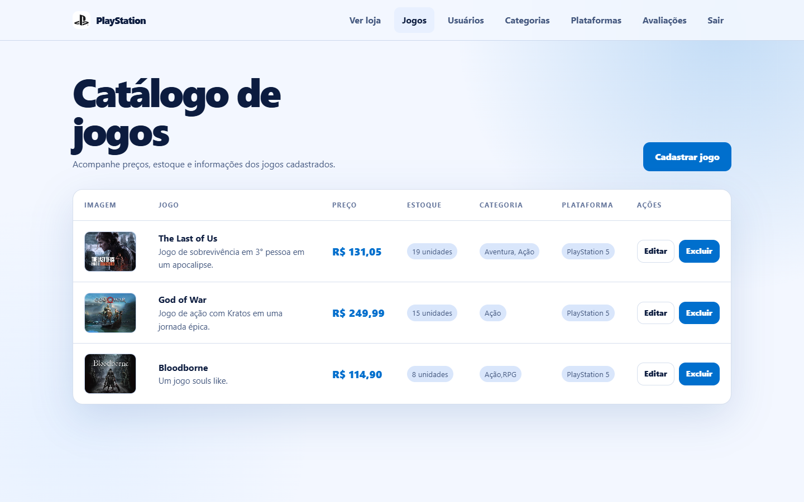
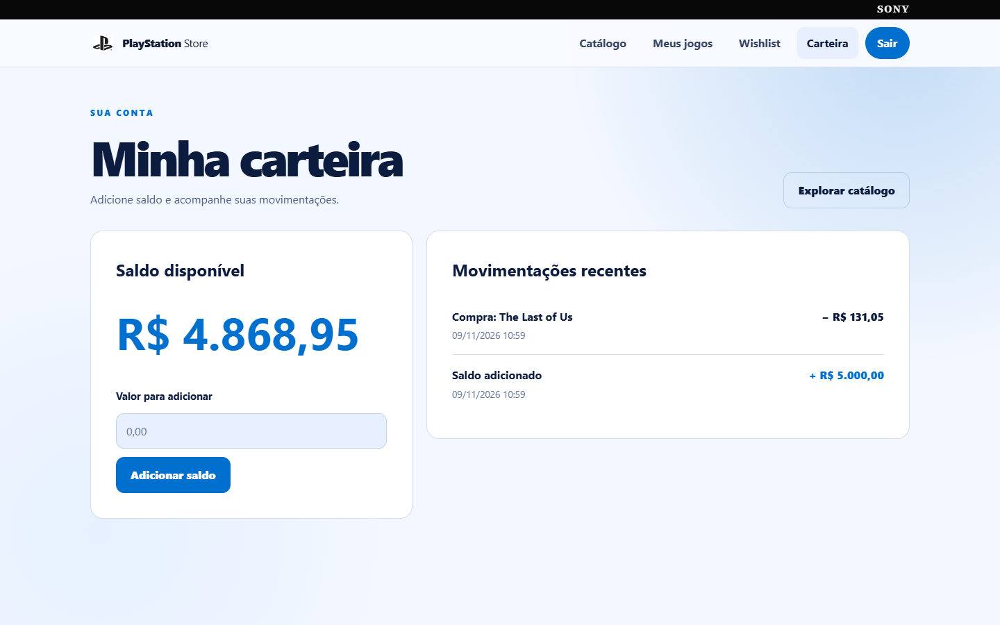
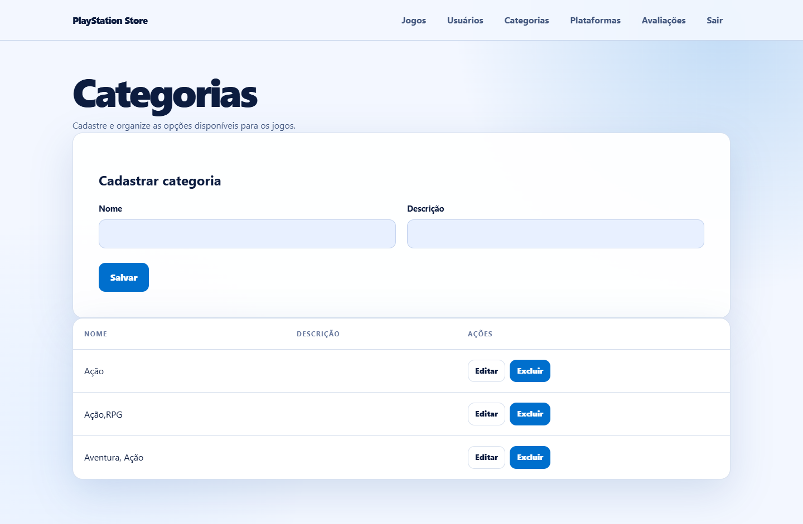
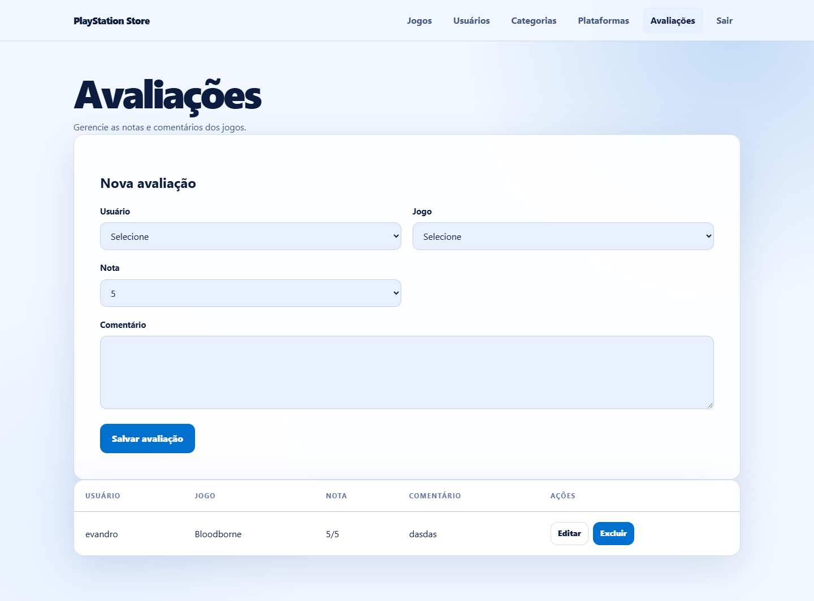

# PlayStation Store

**Integrantes:** Tales Coutinho Carlos

**Tema:** loja de jogos digitais

**Repositório:** [Linguagens-de-progama-o-PHP](https://github.com/TalesCouti/Linguagens-de-progama-o-PHP)

## Descrição

Sistema web de loja de jogos com catálogo público, cadastro de clientes, autenticação, área administrativa e compra com saldo da carteira. O cliente pode manter uma wishlist, consultar a biblioteca de jogos comprados e avaliar os títulos. O administrador gerencia usuários, jogos, categorias e plataformas.

## Tecnologias e organização

- PHP 8 com orientação a objetos, MySQL e PDO.
- Arquitetura MVC: modelos em `admin/models`, controladores em `admin/controllers` e páginas em `admin/views` e na raiz pública.
- Sessões para autenticação e controle de acesso; senhas com `password_hash()` e `password_verify()`.
- HTML, CSS e JavaScript nos formulários e na interface.

## Regras de negócio

- Somente administradores acessam os cadastros administrativos.
- O usuário só pode alterar sua própria wishlist e suas próprias avaliações.
- Cada usuário pode publicar uma avaliação por jogo, com nota de 1 a 5.
- A compra exige estoque e saldo suficientes. Estoque, saldo, compra e movimentação da carteira são atualizados na mesma transação.
- O histórico de compras preserva título e preço mesmo se o jogo for removido do catálogo.
- Categorias e plataformas cadastradas podem ser atribuídas aos jogos. Quando uma delas é excluída, o jogo permanece no catálogo sem essa classificação.

## Classes com CRUD

| Classe | Cadastrar | Consultar | Editar | Excluir |
| --- | --- | --- | --- | --- |
| `Usuario` | Administração e cadastro público | Lista administrativa | Administração | Administração |
| `Game` | Administração | Catálogo e detalhes | Administração | Administração |
| `Categoria` | Administração | Lista e seleção de jogos | Administração | Administração |
| `Plataforma` | Administração | Lista e seleção de jogos | Administração | Administração |
| `Avaliacao` | Cliente ou administração | Página do jogo e administração | Cliente ou administração | Cliente ou administração |

Outras funcionalidades: upload de imagem, página de detalhes, controle de estoque, wishlist, biblioteca, carteira e histórico de movimentações.

## Diagrama de classes UML

## Modelo do banco de dados

O script completo, com banco, tabelas, chaves e dados iniciais, está em [`banco de dados/schema.txt`](banco%20de%20dados/schema.txt).

Tabelas principais: `usuarios`, `games`, `categorias`, `plataformas` e `avaliacoes`. Tabelas de apoio: `carteiras`, `movimentacoes_carteira`, `compras` e `wishlist`.

## Instalação e execução

1. Instale PHP 8, Apache e MySQL, por exemplo com XAMPP. Coloque o projeto em `htdocs/loja_games`.
2. Copie `admin/config/database.local.example.php` para `admin/config/database.local.php` e informe a senha local do MySQL. Também é possível usar a variável de ambiente `DB_PASSWORD`. O arquivo local é ignorado pelo Git.
3. Em uma instalação nova, importe `banco de dados/schema.txt` no MySQL. Em um banco anterior, execute as migrações `migracao_interacoes.sql`, `migracao_carteira.sql` e `migracao_catalogo.sql`, nessa ordem. Se a coluna `telefone` já existir, pule somente o primeiro `ALTER TABLE` da migração de interações.
4. Abra `http://localhost/loja_games/`.

**Conta de teste:** `evandro@gmail.com` / `admin123` (administrador). A senha inicial deve ser alterada em uma instalação compartilhada.

Para conferir as cinco classes no banco local, execute `php tests/smoke_crud.php`. O teste usa uma transação e desfaz os registros temporários ao terminar.

## Capturas das principais telas

| Catálogo | Detalhes e avaliação |
| --- | --- |
|  |  |

| Cadastro | Administração | Carteira |
| --- | --- | --- |
|  |  |  |

| Categorias | Avaliações |
| --- | --- |
|  |  |

As capturas podem ser atualizadas com `python tests/capturar_telas.py`, informando `TEST_ADMIN_EMAIL` e `TEST_ADMIN_PASSWORD` no ambiente.
