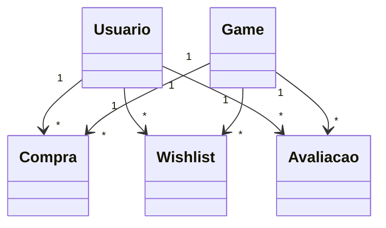

# PlayStation Store

Loja de jogos em PHP 8, MySQL e PDO, com organização MVC nas áreas de modelos, controladores e páginas. Projeto acadêmico. Integrantes: preencher antes da entrega.

## Funcionalidades

- Catálogo público, página de detalhes, compra com controle de estoque e biblioteca do usuário.
- Cadastro de cliente com nome, e-mail, telefone e senha; login e logout com sessão.
- Wishlist pessoal para adicionar e remover jogos.
- Avaliações por jogo: nota de 1 a 5, comentário opcional, edição e exclusão da própria avaliação.
- Área administrativa para gerenciar jogos e usuários.

## Instalação

1. Use PHP 8, Apache e MySQL (por exemplo, XAMPP). Configure os dados de acesso em `admin/config/conexao.php`.
2. Para uma instalação nova, importe `banco de dados/schema.txt` no MySQL.
3. Para um banco já criado com a versão anterior, execute uma vez `banco de dados/migracao_interacoes.sql` no banco `loja_games`. Se a coluna `telefone` já existir, ignore somente o primeiro `ALTER TABLE`.
4. Acesse `http://localhost/loja_games/`.

Contas iniciais após importar o schema: `evandro@gmail.com` / `admin123` (admin) e `pedro@gmail.com` / `user12345` (cliente). Altere as senhas em ambientes compartilhados.

## Modelo de dados

`usuarios` 1:N `compras` N:1 `games`; `usuarios` N:N `games` por `wishlist`; `usuarios` N:N `games` por `avaliacoes` (uma avaliação por usuário e jogo). A exclusão de usuário ou jogo remove as relações de wishlist e avaliações.

## Entrega acadêmica

Faltam preencher os nomes dos integrantes, adicionar capturas das telas e inserir o link público do repositório. O projeto ainda precisa de CRUD completo para cinco classes principais caso essa exigência seja avaliada literalmente; as novas relações de wishlist e biblioteca têm operações próprias de seu domínio.
