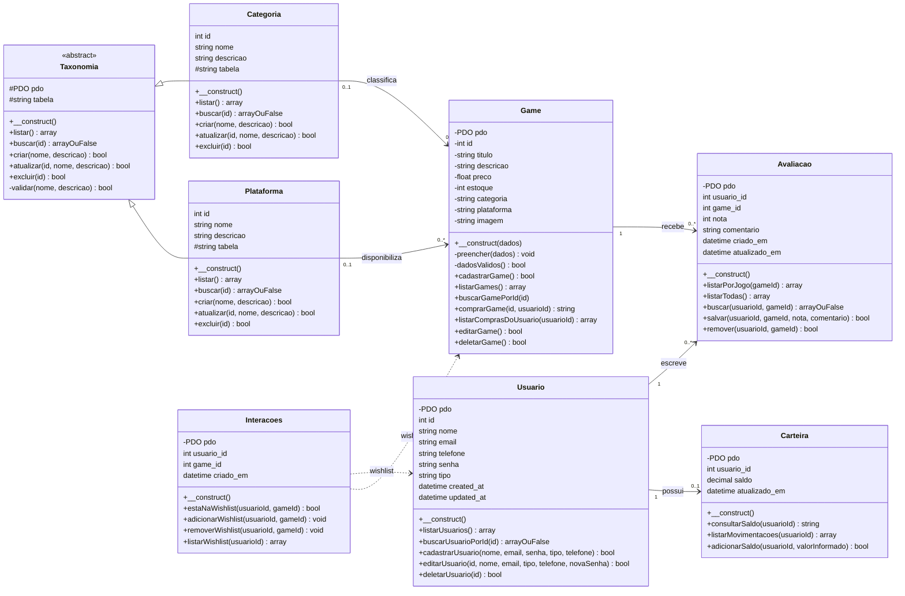

# Diagrama de classes — PlayStation Store

Os atributos apresentados representam os dados persistidos nas tabelas. Os modelos PHP acessam esses dados por PDO; apenas `Game` declara também os campos do jogo como propriedades. Os métodos e a herança abaixo correspondem ao código atual.

`Categoria` e `Plataforma` herdam os métodos mostrados de `Taxonomia`; `arrayOuFalse` representa o tipo PHP `array|false`. `Interacoes` gerencia a tabela `wishlist`. A tabela `compras` não tem classe própria: a compra e a consulta da biblioteca são métodos de `Game`.
